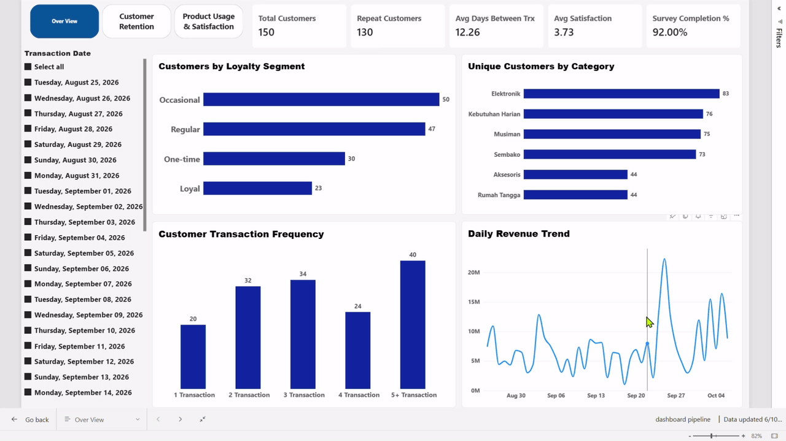
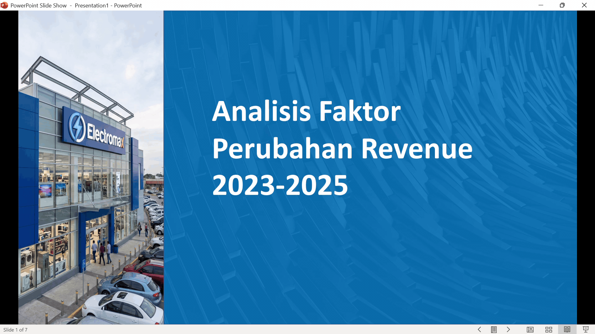

## 1.Executive Summary

### Dashboard Customer Retention & Behavior Analysis — Power BI

### Tujuan

**Membantu tim CRM memahami retensi, frekuensi transaksi, penggunaan produk, dan hubungan kepuasan dengan transaksi berulang**

### Hasil Utama

**86,67% pelanggan bertransaksi berulang (130 dari 150)
Rata-rata jeda antartransaksi 12,26 hari
40 pelanggan bertransaksi 5 kali atau lebih, 20 pelanggan hanya sekali
Rata-rata kepuasan 3,73 / 5 dengan tingkat penyelesaian survei 92%
Elektronik, Kebutuhan Harian, Musiman, dan Sembako dibeli 73-83 pelanggan, jauh di atas Aksesoris dan Rumah Tangga (44 pelanggan)**

### Alur Proyek

**Data sintetis (FastAPI + Faker) → n8n → PostgreSQL (Supabase) → SQL view → Power BI**

### Refresh Otomatis

**n8n memasukkan data baru setiap hari
Power BI Service me-refresh dataset 2 kali sehari**

### Tools

**SQL, PostgreSQL, Power BI (DAX), n8n, Python**

## Dashboard Preview

  

## Resume

📄 [Download My Resume](./cv/Resume.docx)

---
## 2.Executive Summary

### Analisis Faktor Perubahan Revenue 2023-2025

**Pertanyaan**

- Faktor apa yang paling memengaruhi kenaikan dan penurunan revenue perusahaan?

### Hasil Utama

- Revenue Rp82,28 miliar (2023), naik 1,8% jadi Rp83,72 miliar (2024), lalu turun 3,1% jadi Rp81,09 miliar (2025)
- Perubahan revenue lebih dipengaruhi AOV daripada jumlah transaksi:
   2024: AOV naik 1,5%, transaksi hanya naik 0,2%
   2025: AOV turun 2,5%, transaksi turun 0,6%
- Kenaikan AOV 2024 terutama didorong unit per transaksi (71,4%)
- Penurunan AOV 2025 terutama berasal dari realisasi harga (36,6%), diikuti harga list rata-rata (32,7%) dan unit per transaksi (30,7%)
- Dari sisi promo, hilangnya Cashback (Rp1,73 miliar) menjadi penyebab utama penurunan 2025, diikuti Tanpa Promosi dan Diskon
- Bundling satu-satunya yang naik di 2025 (Rp208 juta) dan menahan penurunan total

### Rekomendasi

- Evaluasi promo Cashback lebih dulu, karena menentukan revenue 2024 dan 2025
- Pulihkan AOV dengan mengendalikan diskon, memperkuat penjualan model premium, dan menaikkan unit per transaksi
- Jadikan Bundling kandidat utama untuk menaikkan unit per transaksi

## Report Preview

  

---

## Tools Used in Project

- Microsoft Excel
- Power Query
- Power Pivot
- DAX
- Power Point

## Skills Used in Project

- Data Profiling
- Data Cleaning
- Dekomposisi revenue: Revenue = Jumlah Transaksi × AOV, untuk memisahkan pengaruh volume dari nilai per transaksi
- Dekomposisi AOV: AOV = Harga List Rata-rata × Realisasi Harga × Unit per Transaksi, untuk menemukan faktor penggerak tiap tahun
- Analisis kontribusi: menghitung efek tiap faktor dalam rupiah dan persen terhadap total perubahan
- Perbandingan year-over-year: 2023 ke 2024 dan 2024 ke 2025
- Analisis promo: kontribusi Bundling, Cashback, Diskon, dan Tanpa Promosi terhadap perubahan revenue

## Project Files

| File | Description |
|---|---|
| [Report Preview](./analysis/Presentation1.pptx) | Report File PPTX |
| [File Analysis](./data/raw/Retail%20-%20Electromax%20dirty.xlsx) | File Used |

---

## 3.Executive Summary

- Quantity pada Tabel orders terdapat 252 baris (7.6%) Anomali nilai 0 dan lebih kecil darinya dan terdapat Outlier 74 baris (2.2) jauh dari pola normal nya
  di anggap sebagai kesalahan input dan di tandai dengan Flag
- pada kolom ship_date terdapat Anomali data quality, nilai null 31 (4.62%) dengan status Completed, 
  data nya tetap di pertahankan di dataset untuk transparansi. Ditandai dengan Flag
- number phone pada Tabel customers terdapat inkonsistensi format lintas negara kolom ini di exclude dalam clening
  karna tidak di gunakan dalam analysis
- 225 customer (27.6% dari total) memiliki ***membership_type*** tanpa signup_date. Ditandai dengan Flag

---
## Data Cleaning Retail Mart

### Tabel orders

- Before Cleaning

  

- After Cleaning 

  

- Kolom Quantity terdapat 252 baris (7.6%) Anomali dengan nilai 0 atau lebih kecil darinya, dan secara bisnis mustahil terjadi pada transaksi yang sah, dan di anggap sebagai kesalahan input data. dan Ditandai dengan Flag ***is_quantity_invalidi***.

- Outlier pada Kolom Quantity 74 baris (2.2%) dan terdeteksi mengunakan metode IQR, angka tinggi ini secara teori tidak langsung di anggap salah, tetapi tetap perlu di verifikasi lagi karena lompatan nya sangat jauh dari pola normal nya. Ditandai dengan flag is_quantity_outlier
  
- pada kolom ship_date terdapat anomali data quality, nilai null 31 (4.62%) dengan status Completed, 
data nya tetap di pertahankan di dataset untuk transparansi. Ditandai dengan Flag is_ship_date_missing_anomaly

### Tabel Customers

- Before Cleaning

  

- After Cleaning

  

- kolom number phone terdapat inkonsistensi format lintas negara kolom ini di exclude dalam clening
karna tidak di gunakan dalam analysis

- 225 customer (27.6% dari total) memiliki ***membership_type*** tanpa signup_date. Distribusi merata di seluruh tier (Platinum 27.1%, Bronze 26.2%, Silver 23.6%, Gold 23.1%) menunjukkan anomali ini bersifat sistemik bukan terkait tier tertentu kemungkinan besar berasal dari proses pencatatan signup yang tidak konsisten atau migrasi data historis. Ditandai dengan Flag data_completeness_flag

***Anomali di Data, tidak langsung dihapus atau ditebak melainkan di buat flag. Keputusan untuk mengisi atau membuang data yang bermasalah tergantung kebutuhan analisis, flag memberi transparansi dan fleksibilitas ke pengguna data di tahap berikutnya, tanpa menyembunyikan masalah aslinya.***

Query Data Cleaning Retail Mart  [HERE](./sql/SQL-RetailMart_Clening.sql).

---

Project ini dibuat sebagai portfolio untuk menunjukkan kemampuan melakukan analisis data end-to-end, mulai dari data preparation, data modeling, KPI calculation, statistical analysis, customer segmentation, rule-based modeling, model validation, hingga business recommendation.
