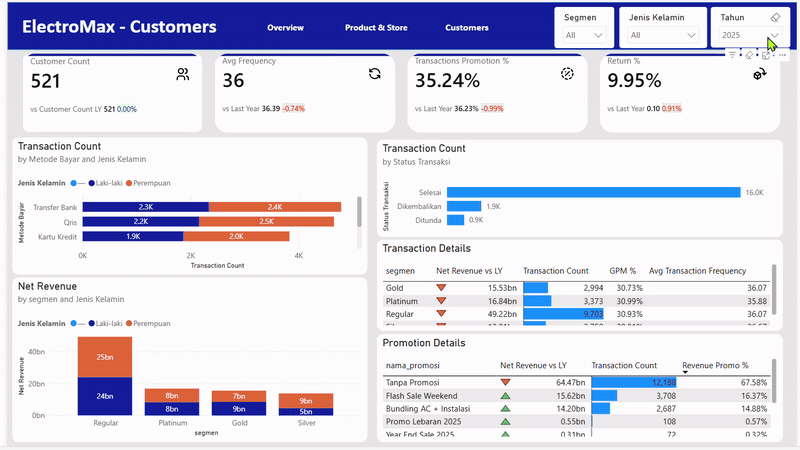
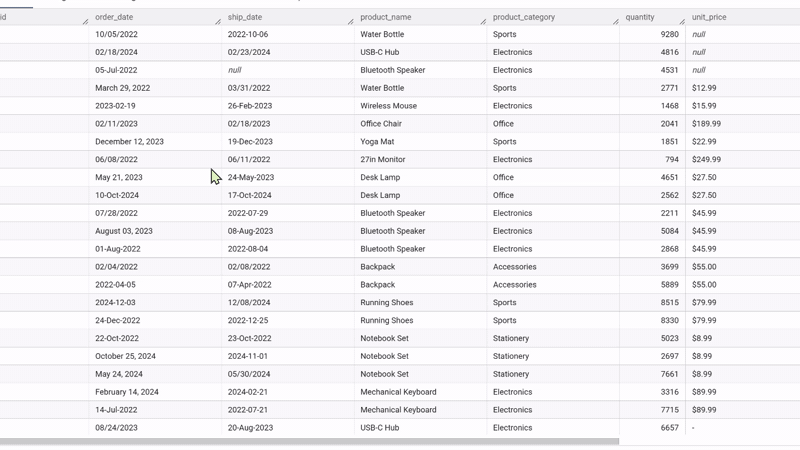
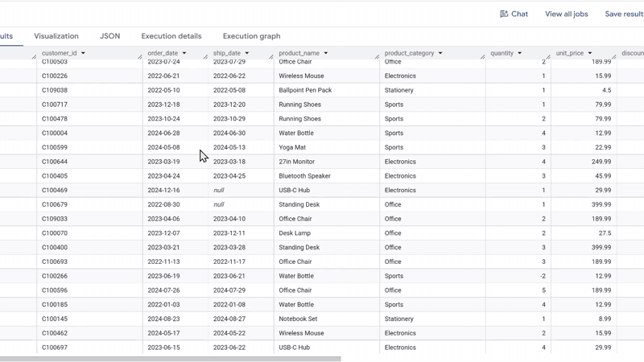
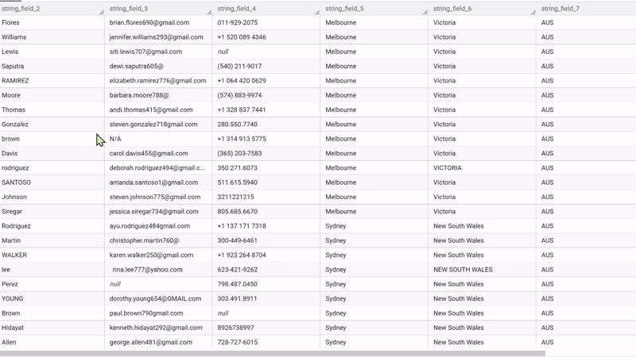
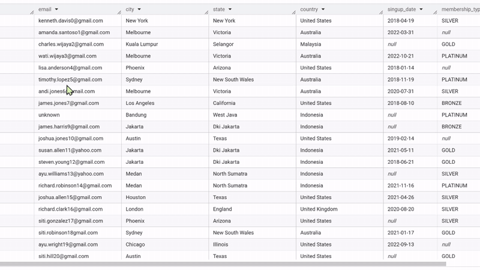

# ElectroMax Sales, Revenue & Customer Behavioral Analysis

## Dashboard Preview

  

---
## Project Files

| File | Description |
|---|---|
| [Excel Analysis](./analysis/Retail%20-%20ElectroMax.xlsx) | Data preparation and analysis |
| [Power BI Dashboard](./dashboard/Retail%20-%20ElectroMax.pbix) | Interactive dashboard |
| [Dashboard Preview](./assets/ElectroMax_Dashboard.gif) | Dashboard GIF preview |
---

## Tentang Project

Project ini bertujuan untuk menganalisis performa penjualan ElectroMax selama periode 2023–2025 serta memahami faktor yang berkaitan dengan perubahan revenue dan perilaku pelanggan.

## Executive Summary

- Perubahan revenue berkaitan dengan jumlah Transaksi tetapi AOV menjadi faktor penting ketika transaksi meningkat tetapi revenue turun
   pada periode Mei AOV YoY(-6,99%) dan Juni AOV YoY (-5,60%)
- Transaction YoY memiliki hubungan paling kuat dengan Revenue YoY (r = 0.747).
- Customer segment Declining menjadi prioritas utama retention karena berkontribusi 41.75% terhadap revenue 2024.
- RFM-based risk scoring belum menunjukkan kemampuan yang konsisten dalam mengidentifikasi pelanggan At Risk pada 2025.

## Dataset

Dataset terdiri dari data transaksi penjualan ElectroMax selama periode 2023–2025.

Data digunakan untuk menganalisis:

- dim_karyawan
- dim_pelangan
- dim_produk
- dim_toko
- dim_promosi
- dim_waktu
- fact_penjualan
---
#### Analisis dilakukan melalui dua fokus utama:

### 1. **Sales & Revenue Analysis**
   - Menganalisis perkembangan revenue
   - Menganalisis korelasi YoY
   - Menganalisis AOV
   - Mengidentifikasi faktor yang berkaitan dengan perubahan revenue

#### pertanyaan

**Faktor apa yang paling berkaitan dengan penurunan atau peningkatan revenue perusahaan?**

#### insight

Perubahan revenue paling sering berkaitan dengan perubahan transaksi. Namun, AOV menjadi faktor penting pada periode tertentu,
terutama ketika transaksi meningkat tetapi revenue tetap menurun seperti Mei dan Juni 2025.

#### rekomendasi

Prioritaskan pertumbuhan transaksi sebagai pendorong utama pertumbuhan revenue, karena Transaction YoY memiliki korelasi terkuat dengan Net Revenue YoY (r = 0,747).
Meski demikian, pertumbuhan transaksi perlu dibarengi dengan strategi untuk menjaga AOV, terutama melalui bundling, upselling, dan penetapan ambang batas promosi yang tepat sasaran.
Penurunan revenue yang signifikan pada Oktober 2025 perlu diselidiki lebih lanjut berdasarkan channel, produk, dan toko untuk mengidentifikasi sumber utama hilangnya transaksi.

---

### 2. **Customer Behavioral & Retention Analysis**
   - RFM Analysis
   - Mengidentifikasi perubahan perilaku pelanggan
   - Membuat rule-based customer risk scoring
   - Membandingkan Risk Score 2024 dengan actual customer behavior 2025
   - Mengevaluasi kemampuan awal risk scoring dalam mengidentifikasi customer yang mengalami penurunan aktivitas

#### pertanyaan

**Bagaimana perubahan perilaku pembelian pelanggan dari 2024 ke 2025 dapat digunakan untuk mengidentifikasi pelanggan yang berisiko churn,
mengukur potensi dampak terhadap revenue, dan menentukan prioritas strategi retention?**

#### insight & rekomedasi

Analisis menunjukkan bahwa kelompok **Declining** merupakan prioritas utama retention karena mencakup 38,58% pelanggan dan berkontribusi 41,75% terhadap revenue 2024
Sementara itu, kelompok **At Risk** memiliki penurunan frequency paling tajam sebesar 39,30%,
sehingga memerlukan intervensi re-engagement untuk mencegah penurunan lebih lanjut.
Di sisi lain, kelompok **Increasing** yang mencakup 37,24% pelanggan dengan pertumbuhan frequency 29,46% merupakan peluang untuk strategi upselling dan cross-selling.

- Eksperimen risk scoring berbasis RFM 2024 belum menunjukkan kemampuan yang konsisten dalam memprediksi pelanggan At Risk pada 2025.
Oleh karena itu, risk score tersebut lebih tepat digunakan sebagai indikator eksploratif, bukan sebagai model prediksi churn final.

## Tools Used in Project

- Google BigQuery
- Microsoft Excel
- Power Query
- Power Pivot
- DAX
- Power BI

## Skills Used in Project

- Data Profiling
- Data Cleaning
- Data Transformation
- Data Modeling
- KPI Analysis
- RFM Analysis
- Correlation Analysis
- Customer Segmentation
- Rule-Based Risk Scoring
- Model Evaluation
- Business Analysis
- Data Visualization
- Business Recommendation

---

## Data Cleaning Retail Mart

### Tabel orders

#### Before Cleaning

  

#### After Cleaning 

  

- Kolom Quantity terdapat 252 baris (7.6%) Anomali dengan nilai 0 atau lebih kecil darinya, dan secara bisnis mustahil terjadi pada transaksi yang sah, dan di anggap sebagai kesalahan input data. dan Ditandai dengan Flag ***is_quantity_invalidi***.

- Outlier pada Kolom Quantity 74 baris (2.2%) dan terdeteksi mengunakan metode IQR, angka tinggi ini secara teori tidak langsung di anggap salah, tetapi tetap perlu di verifikasi lagi karena lompatan nya sangat jauh dari pola normal nya. Ditandai dengan flag is_quantity_outlier
  
- pada kolom ship_date terdapat anomali data quality, nilai null 31 (4.62%) dengan status Completed, 
data nya tetap di pertahankan di dataset untuk transparansi. Ditandai dengan Flag is_ship_date_missing_anomaly

### Tabel Customers

#### Before Cleaning

  

#### After Cleaning

  

- kolom number phone terdapat inkonsistensi format lintas negara kolom ini di exclude dalam clening
karna tidak di gunakan dalam analysis

- 225 customer (27.6% dari total) memiliki ***membership_type*** tanpa signup_date. Distribusi merata di seluruh tier (Platinum 27.1%, Bronze 26.2%, Silver 23.6%, Gold 23.1%) menunjukkan anomali ini bersifat sistemik bukan terkait tier tertentu kemungkinan besar berasal dari proses pencatatan signup yang tidak konsisten atau migrasi data historis. Ditandai dengan Flag data_completeness_flag

***Anomali di Data, tidak langsung dihapus atau ditebak melainkan di buat flag. Keputusan untuk mengisi atau membuang data yang bermasalah tergantung kebutuhan analisis, flag memberi transparansi dan fleksibilitas ke pengguna data di tahap berikutnya, tanpa menyembunyikan masalah aslinya.***

Query Data Cleaning Retail Mart  [HERE](./sql/SQL-RetailMart_Clening.sql).

---

Project ini dibuat sebagai portfolio untuk menunjukkan kemampuan melakukan analisis data end-to-end, mulai dari data preparation, data modeling, KPI calculation, statistical analysis, customer segmentation, rule-based modeling, model validation, hingga business recommendation.
